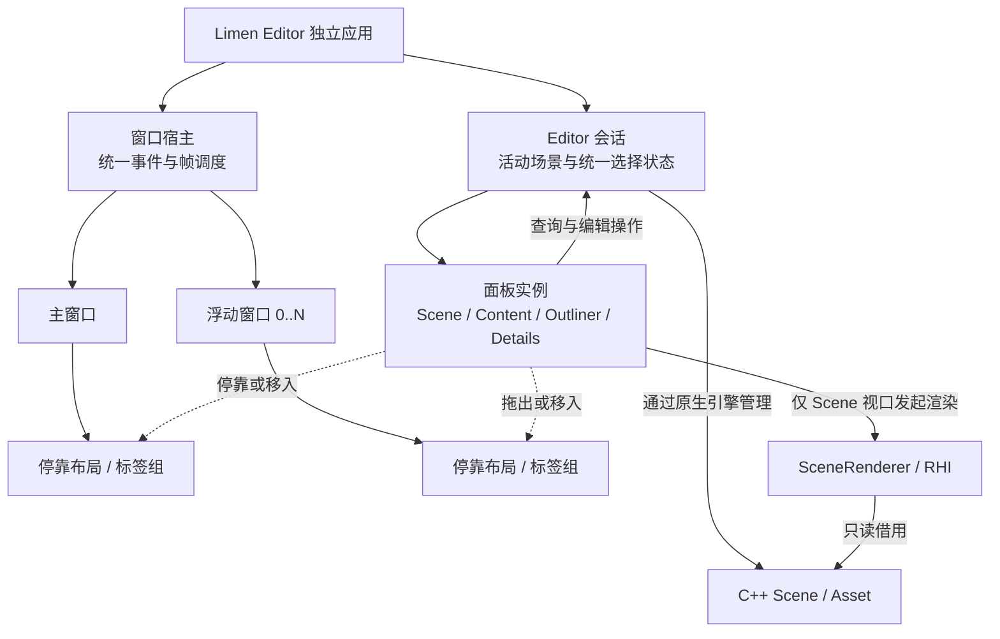

# Limen Editor

> 状态：`LimenEditor` 已有单窗口 C++ 自研工作区，主视口位于左侧，右列上方为 Outliner，下方为 Details。支持底部资源抽屉、模型放置、变换编辑，以及场景保存和打开。自由停靠和多原生窗口待完成。C# 用于计划中的游戏脚本 1.0。

## 当前已实现

- `EditorApp` 注册 `EditorUILayer`；引擎在场景更新、窗口清屏之后调用 `OnUIRender()` 绘制正式 Editor UI，不依赖 Sandbox 的 ImGui。
- `EditorUILayout` 使用逻辑窗口尺寸计算工具栏、Outliner、Scene 视口、Inspector、资源抽屉和状态栏。窄窗口优先保留场景面积。拖动抽屉上边缘或右列的分隔条，松开后调整高度。
- `EditorUIRenderer` 通过 OpenGL 后端绘制纯色、纹理与文字，设置矩形裁剪并区分逻辑窗口坐标与帧缓冲像素尺寸；面板输入命中由各自保存的逻辑矩形负责。
- 底部 **Content Drawer**、`Cmd/Ctrl+J` 或 `Ctrl+Space` 开关资源抽屉。点击目录卡片进入当前资产根下的目录，用 **Up** 返回上一级。已注册且存在的 OBJ 卡片可拖到视口中放置，双击场景卡片可打开关卡。
- 视口上方的活动场景标签显示关卡名称和未保存标记 `*`。打开成功后，状态栏短暂显示 `Opened scene <名称>`。
- 视口 **Frame** 或光标位于视口时按 `F`，按选中对象的世界包围盒取景。**Expand** 临时展开视口，**Restore** 或 `Esc` 恢复工作区。
- 单选对象后，在 **Details** 点击 Location、Rotation 或 Scale 的数值字段，输入以逗号或空格分隔的三个数。旋转单位是度。`Enter` 应用，`Esc` 取消。
- `LimenEditorUILayout` CPU 测试覆盖常规与放大窗口的布局比例、右侧总高、极矮窗口和矩形命中边界；它不替代窗口画面与输入验证。
- `LimenOpenGLEditorUITextureTests` 使用非对称 RGBA 纹理与隐藏 OpenGL 窗口读回像素，验证 UV、sRGB、Alpha 以及逻辑尺寸到 2 倍帧缓冲尺寸的映射；这不是实际 Retina 显示器或可见 Editor 窗口的验收。

### 新建、打开和保存场景

打开项目后，可以通过窗口顶栏的 **File** 工具区或 macOS 菜单栏的 **File** 新建、打开、保存和另存为场景。快捷键分别是 `Cmd/Ctrl+N`、`Cmd/Ctrl+O`、`Cmd/Ctrl+S` 和 `Cmd/Ctrl+Shift+S`。macOS **Edit → Delete Selection** 删除当前选中的场景对象。

- 第一次保存会弹出另存为对话框。保存成功后，Editor 使用该路径继续保存，并清除顶栏的 `*`。
- 有未保存修改时，新建或打开场景会询问保存、放弃或取消。打开失败会保留活动场景、选择和文件路径。
- 文件选择和确认对话框目前走 macOS 原生实现。

在 CLion 的 `LimenEditor` Run Configuration 中，将 `--project` 开始的参数填入 **Program arguments**。Editor 读取项目目录下的 `Config/DefaultGame.toml`，通过 Asset Registry 找到并打开配置指定的场景。未设置启动场景的项目从空场景开始。

要临时打开其他场景，可传入 `--scene` 覆盖此次启动。把两个示例路径换成实际路径。

```bash
./out/LimenEditor --project "/path/to/Game.lmproject" --scene "/path/to/Level.lscene"
```

场景资源全部解析成功后，Editor 会切换活动场景并清除对象选择和脏标记。失败时保留活动场景，状态栏提示失败，日志给出场景路径、出错字段和原因。

### Forest Outpost 示例关卡

仓库附带 [Forest Outpost](../samples/ForestOutpost/README.md)，可用来验证场景打开、OBJ 模型摆放和 Details 变换编辑。从仓库根目录启动后，视口会显示城堡、房屋、树林和地块。

```bash
./out/LimenEditor --project samples/ForestOutpost/ForestOutpost.lmproject
```

## 已确认的架构规则

以下是正式 Editor 的目标规则；多窗口、面板停靠和共享编辑状态目前仍未实现。

1. **独立应用：**Limen Editor 与 `LimenSandBox` 是两个客户端，分别使用 C++ 引擎核心；正式功能不继续堆进 Sandbox，Sandbox 保留为渲染实验和回归入口。
2. **一个会话、多窗口：**同一个 Editor 会话可以管理主窗口和多个浮动原生窗口。窗口是面板的承载位置，不各自创建一份场景。一个统一的 UI/渲染调度者管理这些窗口；这不等于只能打开一个窗口。
3. **面板与窗口分离：**Scene 视口、Content Browser、Outliner 和 Details 是可停靠的面板。面板可以在主窗口内重排，也可以拖出成为浮动窗口，再重新停靠。默认布局参考 UE 的工作流，但不照搬其图标、样式或源码。
4. **共享编辑状态：**同一会话中的 Outliner、Details 和各窗口读取同一个活动场景与选择状态。拖动或关闭浮动窗口只影响窗口及其中的面板，不复制或销毁场景；重新打开面板后仍能访问该会话。
5. **区分数据所有权：**实际 `Scene`、Asset 和 GPU 资源由 C++ 引擎侧管理。Editor 会话管理当前场景的使用与编辑状态；窗口和普通面板只借用这些数据，不拥有或释放场景。`SceneRenderer` 渲染时只读取 `Scene`，不负责 Editor 窗口和停靠布局。
6. **视口有自己的视图状态：**Scene 视口面板可以拥有自己的相机、尺寸和显示状态，但引用同一活动场景。多个视口是否各自拥有 `SceneRenderer`、如何共享图形资源和处理 Context 生命周期，需在视口设计阶段验证。
7. **技术路线已确定：**正式 Editor 使用 C++ 自研 UI；C# 用于计划中的游戏脚本 1.0，不用于 Editor UI。现有 ImGui 继续作为 Sandbox 调试工具。
8. **会话独占活动场景：**`EditorSession` 以独占所有权持有活动 `Scene`；窗口与面板只借用 `const Scene&`，不拥有、不释放。一切修改经会话提供的方法完成，选择与脏状态不可能被面板绕过。对应 UE 的 GEditor 拥有编辑世界与选择集、面板不拥有 Actor。
9. **选择只存稳定身份：**选择状态以 `SceneObjectID` 为键，不保存运行期句柄或数组下标；对象销毁后旧 ID 自动失效并从选择中清除。接口先按单选实现，但形状兼容后续多选。
10. **脏状态显式转换：**成功的编辑操作置脏，成功保存或切换场景清除脏；保存失败时保留编辑状态。
11. **创建即选中：**新建对象自动成为当前选择，对应 UE 中 Spawn 后自动选中。

默认工作区参考 UE5 Level Editor。场景编辑使用主视口，Outliner 和 Details 集中在右列，资源浏览使用底部抽屉。布局状态由 Editor 界面管理。 [UE 编辑器界面](https://dev.epicgames.com/documentation/en-us/unreal-engine/unreal-editor-interface)

## 逻辑架构

以下名称表示设计职责，**不是当前仓库中已经存在的类或接口**。



窗口、停靠位置和面板内容是三个不同层次：把 Outliner 从主窗口拖到浮动窗口，改变的是停靠关系；`Scene` 和选择状态仍属于同一个 Editor 会话。关闭浮动窗口后，场景继续存在。布局配置应与场景数据分别保存，避免移动面板触发场景文件修改；布局持久化的具体格式尚未设计。

## 当前代码与目标之间的差距

- 当前已有单窗口真实 Scene 视口、模型/内置对象放置、同步面板与场景文件命令。停靠、多原生窗口、通用输入焦点、Gizmo 和 Undo/Redo 待完成。
- 目前 [`Application`](../LimenEngine/include/Limen/Application/Application.h) 只持有一个 `Window`，主循环只轮询并呈现这一个窗口；多窗口宿主尚未实现。
- Sandbox 的 [`ImGUILayer`](../LimenEngine/src/Editor/ImGui/ImGUILayer.cpp) 启用停靠，但关闭了多原生窗口。仅开启 ImGui 的多视口标志不能替代正式 Editor 的窗口、面板和状态所有权设计。
- [`Example3DLayer`](../LimenSandBox/src/Example3DLayer.h) 将测试场景、`SceneRenderer` 与视口状态放在一个 Layer 中；正式 Editor 需要把跨面板共享的场景/选择状态与每个视口自己的状态分开。
- 当前 [`SceneObjectHandle`](../LimenEngine/include/Limen/Scene/Scene.h) 已带 Generation，稳定身份由 `SceneObjectID` 承担。场景可通过窗口命令、项目启动配置或显式启动参数打开。关闭窗口时的未保存确认待完成。

## 接下来执行的顺序

Editor 服务于根目录 [README 的 G0–G4 游戏交付主线](../README.md)，不是单独无限扩张的 UI 技术演示。每个节点都以真实项目数据和可重复操作验收：

1. **G0：收稳最小 UI 路径。**用非对称 RGBA 图验证纹理 UV、颜色、Alpha、缩放与高 DPI；保留已有“松开才调整、区域可接近收起”的分隔条交互，并复验窗口缩放、非全屏最大化、最小化恢复及非零尺寸变化到下一次绘制之间的旧命中区域。让 `LimenEditor` 有显式构建/测试入口。
2. **G1 项目、资产与场景（进行中）。**已接入项目启动场景、稳定 AssetID、Authoring 快照、场景文件序列化和 Editor 场景命令。接下来补齐关闭窗口时的未保存确认。
3. **G2：做出可用的场景编辑器。**只补齐真实面板需要的文字、裁剪、焦点与事件路由；中央 Scene 视口消费 `SceneRenderer` 的最终颜色，按视口尺寸更新离屏目标与相机宽高比，并检查逻辑尺寸、帧缓冲像素尺寸及 GPU Context 生命周期。Hierarchy/Outliner、Inspector/Details、Content Browser 操作同一场景。加入 Picking、Transform 编辑、Undo/Redo、保存反馈；以“修改后关闭重开仍一致”验收。UI 不拥有或释放 Scene。
4. **G3–G4：接入游戏工作流。**Play/Stop 使用隔离的运行世界，Editor 将构建/发布入口连接到独立 Player、C# 游戏脚本和 Cooker；游戏能力及发布包由引擎主线负责，Editor 不复制一套运行时。
5. **后续工作区能力。**真实面板、输入焦点和资源生命周期稳定后，再做停靠、浮动原生窗口与独立于场景的布局持久化；多窗口共享同一个 Editor 会话，不是 G2 基本编辑闭环的前置条件。

上述是依赖与验收顺序，不表示目标能力已实现。OpenGL 实现留在 Editor 后端，不把图形 API 类型带入通用 UI 接口；新增字体等第三方依赖前仍需评估方案。C# 只用于 G3 起的游戏脚本。

## 当前迭代顺序：A → B → C → D

在 G0 收尾与 G1 会话接入之间按四个工作包推进，每包都有独立验收句；当前约定是 Editor 生产代码由 Codex 实现，涉及 Engine 公共接口或场景数据结构的改动先提交方案由用户实现。

### A：会话数据契约（已完成）

- 范围：`src/Project/EditorSession.h` 扩展活动 Scene、统一选择与脏状态；`tests/EditorSessionTests.cpp` 覆盖选择、失效、多选、批量删除与脏标记。
- 关键接口：`CreateObject`（创建即选中）、`CreateRenderableObject`、`SelectObject`、`ToggleObjectSelection`、`SelectObjects`、`DeleteSelectedObjects`、`GetSelectedObjectIDs/Count`、`DeleteObject`、`SetSelectedObjectTransform`、`TryGetSelectedObjectTransform`、`GetScene`（const 借用）、`IsDirty/ClearDirty`。
- 验收：`LimenEditor` 编译通过；`LimenEditorSession` 测试全绿。

### B：真实场景视口（已完成）

- 中央区域升级为真视口：视口组件拥有自己的相机与 `SceneRenderer`，共享会话的活动 Scene；`OnUpdate` 渲染离屏、`OnUIRender` 把最终颜色画进中央矩形。
- 新增：UI 后端“原生纹理句柄”绘制入口、直通采样、hover 焦点路由，以及 UE 式右键环视/飞行、中键平移、滚轮推拉缩放。
- 验收：启动 `LimenEditor --project <项目>`，中央视口显示场景，视口内可旋转/缩放相机，窗口放大两倍时清晰不变形。

### C：面板骨架与文字（已完成基础）

- 补齐字体图集、文字渲染与矩形裁剪；Content Browser 列出资产路径并提供显式 Place，Outliner 只列出并管理已有场景对象，优先显示模型 Label，支持单选、Command/Ctrl 多选、Shift 范围选择；Details 显示单选 Label、Transform、Authoring Component 摘要或多选数量。
- `EditorTheme` 采用石墨色与琥珀色选中提示。顶栏展示项目、场景和常用命令，窄窗口按可用宽度换行。Details 提供选中对象的变换编辑和组件摘要，视口工具栏提供取景和展开。
- 视口支持世界空间射线-AABB 拾取：左键点击选择对象，Command/Ctrl 增选，点击空白清空对象选择。
- 鼠标输入采用 `Scene Viewport → Content Browser → Outliner → Splitter → 快捷键` 的固定优先级；前一个区域消费事件后，后续区域不再重复处理。
- 引擎侧新增 `Scene::ForEachObject/ForEachRenderableObject` 与 `AssetRegistry::ForEachRecord`，面板只读借用数据。
- 验收：面板显示会话真实数据；选择、删除在面板间同步；字体方向、裁剪和纹理直通 GPU 测试通过。

### D：资产与内置对象生成（进行中）

当前有三个显式 Place 入口：

- Content Browser 的 `Place`：放置当前选中的 OBJ 模型资产；
- 顶栏 `Add → Cube`：创建一个带 `PrimitiveRendererComponent(PrimitiveType::Cube)` 和共享 Cube Mesh/Material 的可渲染对象。
- 顶栏 `Add → Point Light`：创建带 `PointLightComponent` 的光源对象，其根 TRS 的 Translation 决定灯光世界位置。

内置对象使用 `Cube`、`Cube_2`、`PointLight`、`PointLight_2` 这类唯一 Label。按钮使用 350 ms 命令去抖，双击不会重复生成两个对象。Outliner 不拥有创建按钮。

模型资产放置流程参考 UE 的 Content Browser 选中资产 → Place：

1. Content Browser 的资产卡片单击调用 `EditorSession::SelectAsset(AssetID)` 并高亮。双击场景资产进入同一条场景打开流程，当前场景有未保存修改时先确认。资产选择与场景对象选择互相独立。按住 OBJ 卡片拖动超过 5 个逻辑像素后可进入 Scene 视口，在释放位置生成对象。
2. `Place` 要求存在选中资产且 `AssetRecordStatus::Present`；资产缺失或加载失败时不修改 Scene，并留下明确诊断。
3. 通过 `AssetRegistry` 的 `LogicalPath` 调用 `AssetManager::LoadModel` 加载模型；用 `ModelMaterialBuilder::BuildBlinnPhong` 和 `EditorSceneContent` 的 Blinn-Phong Pipeline 构建运行时材质。
4. 第一版只支持模型资产（OBJ + sidecar）；纹理只作为材质输入，不作为可生成对象。多 Part 模型现在是**一个 SceneObject + 多个渲染组件**，Outliner 只出现一行，Details 显示该实例的 Transform。
5. 每个 part 的 Transform 使用 `ModelPart::LocalTransform`，渲染时与世界 Transform 组合；同一模型实例的多个 part 共享 Mesh/Material 的 `Ref`。生成后对象加入选择，Outliner/Details 立即刷新。
   放置时以模型文件名生成 Label，例如 `TestCube`；同名对象使用 `TestCube_2`、`TestCube_3`。Label 只用于显示和序列化，对象身份仍由 `SceneObjectID` 承担。
6. `Place` 按钮把对象放在视口中心；拖拽释放则按鼠标位置生成世界空间射线，默认距离也是相机前方 4 个世界单位。拖拽开始时读取模型局部 AABB，按当前落点投影为半透明屏幕包围框，同时显示资产路径和距离；滚轮按每次 0.5 个单位在 1.0～20.0 范围调整距离。连续放置不依赖硬编码世界原点。GPU 资源由 Editor 渲染层与 AssetManager 持有，Scene 只借用。
7. 底部状态栏会提示放置成功、失败或拖放取消。

文件范围：`EditorSession`、`EditorSceneContent`、`EditorAssetSpawner`、`EditorPrimitiveSpawner`、`PlacementToolbarPanel`、`SceneViewportPanel`、`EditorUILayer`、Content Browser/Outliner 面板、测试与资产样例。已验证：完整构建和 CTest 通过；临时项目 OBJ 的 OpenGL GPU 端到端测试通过；真实窗口验证 `Cube` 出现在视口且 Outliner/Details 同步，`Point Light` 在 Outliner 新增并选中。验收：模型资产、Cube 和 PointLight 都能从显式 Place 入口创建；失败不留下半成品对象。

PointLight 仍处于迁移期：新建 Editor 光源只使用 `PointLightComponent`；运行期通过 `CollectRuntimePointLights()` 与旧 `Scene::m_PointLights` 合并，兼容尚未迁移的 Sandbox/Renderer 调用。全部调用方迁移后再删除 Scene 级旧点光源数组。

Details 当前只读显示组件：模型优先显示项目逻辑资产路径，Cube 显示 Primitive 类型，PointLight 分行显示 Color 与 Intensity。字段编辑需要 Engine 先提供按 `SceneComponentID` 校验并更新组件的命令接口，Editor 不直接修改 Scene 内部数组。

### UE5 参照边界

借鉴 GEditor 全局选择集、Package Dirty 的脏标记、ViewportClient 每视口独立视图状态、Content Browser 资产选择 → Spawn、Spawn 即选中；不照搬 Slate 停靠框架、反射式 Details 面板与多窗口宿主（G2 之后再议）。

## 尚待决定

- 多窗口下原生视口、输入焦点、高 DPI、GPU 呈现和图形 Context 的具体接入方式；不能默认逐帧把 GPU 图像读回 CPU。
- 面板实例创建/关闭规则、布局持久化格式，以及多个 Scene 视口的资源与相机生命周期。
- 多项目或多 Editor 会话是否在同一进程中运行；当前已确认的多窗口规则只针对同一个会话。

参考资料：[Epic：Slate Overview](https://dev.epicgames.com/documentation/unreal-engine/slate-overview-for-unreal-engine?lang=en-US) · [Epic：Layout Customization](https://dev.epicgames.com/documentation/en-us/unreal-engine/layout-customization?application_version=4.27)。借鉴的是可停靠面板、浮动窗口及布局管理的交互原则，不复制 UE 的实现。
