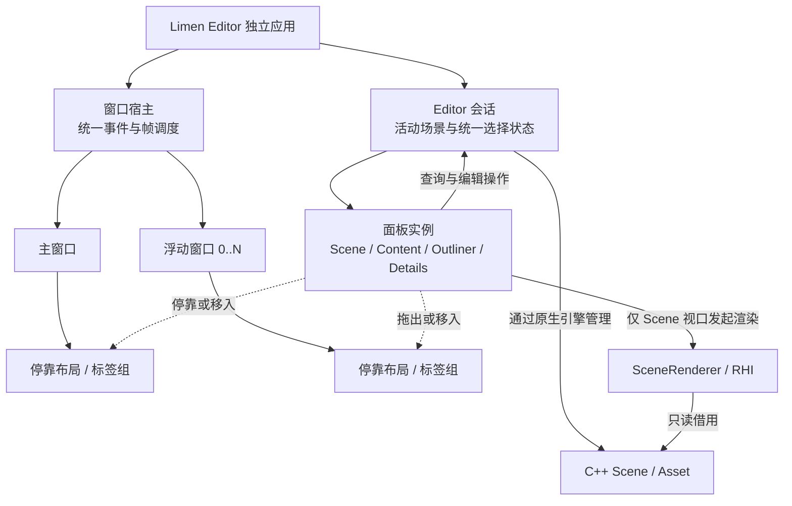

# Limen Editor

> 状态：`LimenEditor` 已有单窗口 C++ 自研 UI 原型：占位布局、纯色与纹理矩形绘制、右侧分隔条交互。非对称 RGBA GPU 测试已覆盖 UV、sRGB、Alpha 和 2 倍尺寸映射；真实 Retina 窗口与交互仍待验证。真正的面板内容、Scene 视口、停靠和多原生窗口尚未实现。C# 用于游戏脚本 1.0，不用于 Editor UI。

## 当前已实现

- `EditorApp` 注册 `EditorUILayer`；引擎在场景更新、窗口清屏之后调用 `OnUIRender()` 绘制正式 Editor UI，不依赖 Sandbox 的 ImGui。
- `EditorUILayout` 使用逻辑窗口尺寸计算顶部、左侧、中央、右上、分隔条和右下六个区域；常规宽度下三栏保持比例，极窄窗口优先满足中央最小宽度，左右栏可能缩至零。
- `EditorUIRenderer` 通过 OpenGL 后端绘制纯色和纹理矩形，并区分逻辑窗口坐标与帧缓冲像素尺寸；目前用引擎白纹理进行最小绘制检查，文字、裁剪和输入焦点尚未接入。
- 右侧分隔条在鼠标按下后记录交互状态，松开时按右侧正文总高（包含分隔条）更新上下比例；不要求分隔条精确贴住松开位置，也不在移动时实时调整。零尺寸帧缓冲事件会取消拖动并清除旧命中区域。
- `LimenEditorUILayout` CPU 测试覆盖常规与放大窗口的布局比例、右侧总高、极矮窗口和矩形命中边界；它不替代窗口画面与输入验证。
- `LimenOpenGLEditorUITextureTests` 使用非对称 RGBA 纹理与隐藏 OpenGL 窗口读回像素，验证 UV、sRGB、Alpha 以及逻辑尺寸到 2 倍帧缓冲尺寸的映射；这不是实际 Retina 显示器或可见 Editor 窗口的验收。

## 已确认的架构规则

以下是正式 Editor 的目标规则；多窗口、面板停靠和共享编辑状态目前仍未实现。

1. **独立应用：**Limen Editor 与 `LimenSandBox` 是两个客户端，分别使用 C++ 引擎核心；正式功能不继续堆进 Sandbox，Sandbox 保留为渲染实验和回归入口。
2. **一个会话、多窗口：**同一个 Editor 会话可以管理主窗口和多个浮动原生窗口。窗口是面板的承载位置，不各自创建一份场景。一个统一的 UI/渲染调度者管理这些窗口；这不等于只能打开一个窗口。
3. **面板与窗口分离：**Scene 视口、Content Browser、Outliner 和 Details 是可停靠的面板。面板可以在主窗口内重排，也可以拖出成为浮动窗口，再重新停靠。默认布局参考 UE 的工作流，但不照搬其图标、样式或源码。
4. **共享编辑状态：**同一会话中的 Outliner、Details 和各窗口读取同一个活动场景与选择状态。拖动或关闭浮动窗口只影响窗口及其中的面板，不复制或销毁场景；重新打开面板后仍能访问该会话。
5. **区分数据所有权：**实际 `Scene`、Asset 和 GPU 资源由 C++ 引擎侧管理。Editor 会话管理当前场景的使用与编辑状态；窗口和普通面板只借用这些数据，不拥有或释放场景。`SceneRenderer` 渲染时只读取 `Scene`，不负责 Editor 窗口和停靠布局。
6. **视口有自己的视图状态：**Scene 视口面板可以拥有自己的相机、尺寸和显示状态，但引用同一活动场景。多个视口是否各自拥有 `SceneRenderer`、如何共享图形资源和处理 Context 生命周期，需在视口设计阶段验证。
7. **技术路线已确定：**正式 Editor 使用 C++ 自研 UI；C# 用于计划中的游戏脚本 1.0，不用于 Editor UI。现有 ImGui 继续作为 Sandbox 调试工具。

参考截图对应的初始工作区：顶部菜单与工具栏、左侧 Content Browser、中间 Scene 视口、右上 Outliner、右下 Details。这只是可恢复的默认布局，不限制用户重新停靠或将面板拖到其他显示器。

## 逻辑架构

以下名称表示设计职责，**不是当前仓库中已经存在的类或接口**。

窗口、停靠位置和面板内容是三个不同层次：把 Outliner 从主窗口拖到浮动窗口，改变的是停靠关系；`Scene` 和选择状态仍属于同一个 Editor 会话。关闭浮动窗口后，场景继续存在。布局配置应与场景数据分别保存，避免移动面板触发场景文件修改；布局持久化的具体格式尚未设计。

## 当前代码与目标之间的差距

- 当前可见区域仍以单窗口占位矩形和白图为主；非对称纹理的 GPU 数值测试不等于正式面板已有真实数据，尚无 Scene 视口或编辑功能。
- 目前 [`Application`](../LimenEngine/include/Limen/Application/Application.h) 只持有一个 `Window`，主循环只轮询并呈现这一个窗口；多窗口宿主尚未实现。
- Sandbox 的 [`ImGUILayer`](../LimenEngine/src/Editor/ImGui/ImGUILayer.cpp) 启用停靠，但关闭了多原生窗口。仅开启 ImGui 的多视口标志不能替代正式 Editor 的窗口、面板和状态所有权设计。
- [`Example3DLayer`](../LimenSandBox/src/Example3DLayer.h) 将测试场景、`SceneRenderer` 与视口状态放在一个 Layer 中；正式 Editor 需要把跨面板共享的场景/选择状态与每个视口自己的状态分开。
- 当前 [`SceneRenderObjectHandle`](../LimenEngine/include/Limen/Scene/Scene.h) 只有数组下标。安全删除、跨面板选择和撤销前，需要按根目录 [README 的 G1](../README.md)完善对象身份及序列化；不把现有句柄直接当成稳定的 Editor 对象 ID。

## 接下来执行的顺序

Editor 服务于根目录 [README 的 G0–G4 游戏交付主线](../README.md)，不是单独无限扩张的 UI 技术演示。每个节点都以真实项目数据和可重复操作验收：

1. **G0：收稳最小 UI 路径。**用非对称 RGBA 图验证纹理 UV、颜色、Alpha、缩放与高 DPI；保留已有“松开才调整、区域可接近收起”的分隔条交互，并复验窗口缩放、非全屏最大化、最小化恢复及非零尺寸变化到下一次绘制之间的旧命中区域。让 `LimenEditor` 有显式构建/测试入口。
2. **G1：等待并接入真实数据契约。**Engine 提供项目配置、稳定 AssetID、场景对象身份与保存/加载；Editor 会话借用活动 Scene/Asset，管理统一选择和脏状态。不能用临时数组下标充当跨面板长期引用。
3. **G2：做出可用的场景编辑器。**只补齐真实面板需要的文字、裁剪、焦点与事件路由；中央 Scene 视口消费 `SceneRenderer` 的最终颜色，按视口尺寸更新离屏目标与相机宽高比，并检查逻辑尺寸、帧缓冲像素尺寸及 GPU Context 生命周期。Hierarchy/Outliner、Inspector/Details、Content Browser 操作同一场景。加入 Picking、Transform 编辑、Undo/Redo、保存反馈；以“修改后关闭重开仍一致”验收。UI 不拥有或释放 Scene。
4. **G3–G4：接入游戏工作流。**Play/Stop 使用隔离的运行世界，Editor 将构建/发布入口连接到独立 Player、C# 游戏脚本和 Cooker；游戏能力及发布包由引擎主线负责，Editor 不复制一套运行时。
5. **后续工作区能力。**真实面板、输入焦点和资源生命周期稳定后，再做停靠、浮动原生窗口与独立于场景的布局持久化；多窗口共享同一个 Editor 会话，不是 G2 基本编辑闭环的前置条件。

上述是依赖与验收顺序，不表示目标能力已实现。OpenGL 实现留在 Editor 后端，不把图形 API 类型带入通用 UI 接口；新增字体等第三方依赖前仍需评估方案。C# 只用于 G3 起的游戏脚本。

## 尚待决定

- 多窗口下原生视口、输入焦点、高 DPI、GPU 呈现和图形 Context 的具体接入方式；不能默认逐帧把 GPU 图像读回 CPU。
- 面板实例创建/关闭规则、布局持久化格式，以及多个 Scene 视口的资源与相机生命周期。
- 多项目或多 Editor 会话是否在同一进程中运行；当前已确认的多窗口规则只针对同一个会话。

参考资料：[Epic：Slate Overview](https://dev.epicgames.com/documentation/unreal-engine/slate-overview-for-unreal-engine?lang=en-US) · [Epic：Layout Customization](https://dev.epicgames.com/documentation/en-us/unreal-engine/layout-customization?application_version=4.27)。借鉴的是可停靠面板、浮动窗口及布局管理的交互原则，不复制 UE 的实现。
