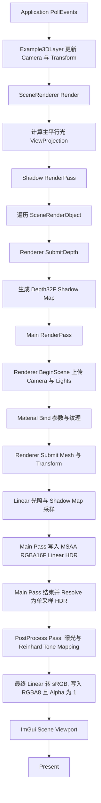
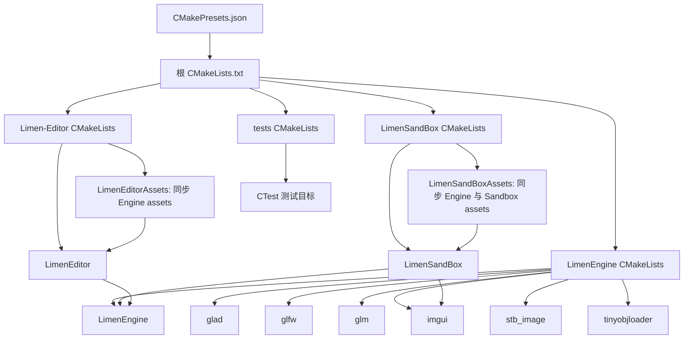
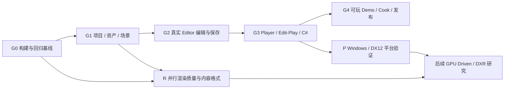

# Limen Engine

Limen Engine 是一个使用 C++20 与 CMake 开发的游戏引擎，现代实时渲染与光追研究是它的长期特色方向。

当前可运行基线是 macOS OpenGL 4.1 渲染、Sandbox 场景实验，以及独立的 C++ 自研 Editor UI 原型。近期首要目标是贯通“创建项目 → 导入资源 → 编辑并保存场景 → 编写游戏行为 → 独立运行 → 构建发布”的工作流，让一个小型游戏真正由 Limen 制作和交付。PBR、glTF、IBL、阴影升级继续推进，但不再全部排在场景、Editor 和运行时之前。

## 项目里程碑

游戏交付主线按依赖推进，渲染和平台路线并行，不把某条研究路线的完成当作另一条路线的启动条件：

| 节点                    | 可验收结果                                                                                                        |
|-------------------------|-------------------------------------------------------------------------------------------------------------------|
| G0 工程基线             | Sandbox 与 Editor 都有明确构建/测试入口；当前渲染与 UI 纹理路径有可重复的回归检查。                               |
| G1 项目、资源与场景     | 项目能重新打开；资产有稳定身份、导入记录和引用诊断；场景对象能安全删除，场景能保存并往返加载。                    |
| G2 可用的 C++ Editor    | 用正式 Editor 查看、选择、修改、撤销和保存真实场景；重新打开后结果一致。                                          |
| G3 独立运行时与 C#      | Player 从项目配置启动场景；Edit/Play 数据隔离；C# 游戏脚本可驱动一个有输入和反馈的游戏行为。C# 不用于 Editor UI。 |
| G4 Limen Game Engine v1 | 一个小型可玩游戏完成必需的碰撞/物理、音频、动画与游戏 UI；资源经过处理并打包，脱离源码目录仍可启动和游玩。        |
| R 渲染路线              | 在现有 HDR/后处理基线上按内容需要推进 PBR、glTF/GLB、IBL、阴影质量、自动化画质回归和 Profiling。                  |
| P 平台与研究路线        | Windows/Direct3D 12 后端与跨平台验证；其后按需求推进 GPU Driven、时域渲染、DXR 与混合光追。                       |

第一个可玩闭环先在已可运行的 macOS 后端完成；从 G0 起维护后端无关的公共接口，为 Windows/Direct3D 12 留出正确的命令与资源状态模型。“完成 v1”以上述 G4 的实测结果为准，不等于复制商业引擎的全部功能。

## 平台状态

| 操作系统      | 图形 API        | 当前状态                   | 优先级     |
|---------------|-----------------|----------------------------|------------|
| macOS         | OpenGL 4.1      | 已实现，当前唯一可运行后端 | 当前基线   |
| Windows       | Direct3D 12     | 尚未实现                   | 后续主目标 |
| macOS         | Metal           | 尚未实现                   | 后续方向   |
| Windows       | Direct3D 11     | 只有枚举与路径预留         | 非当前主线 |
| Linux         | OpenGL / Vulkan | 尚未实现                   | 远期方向   |
| iOS / Android | Metal / Vulkan  | 尚未实现                   | 远期方向   |

`RendererAPI::API` 中存在某个枚举，只表示公共架构预留，不表示对应后端已经可用。当前 Linux 配置阶段会主动报错；Windows 仍缺少可运行的窗口和图形后端，不能把配置成功视作 Windows 支持。

[本机 M1 图形环境记录](docs/MacM1.md)是 2026-10-08 的配置快照，其中关于“主场景尚未启用 HDR”和手动复制资源的描述早于当前实现；涉及项目现状时以本 README 和当前代码为准。

## 当前已经具备的能力

### Application 与基础设施

- Application 主循环、Window、Layer 与 Overlay；
- 键盘、鼠标、窗口事件和跨平台键码接口；
- 正交相机、透视相机与相机控制器；
- 日志、断言、`DeltaTime`、`Scope` 与 `Ref`；
- 自研连续动态数组 `LArray`：原先使用 `std::vector` 的 Scene、Model、Mesh、RHI 等自有数据现由它管理元素生命周期；
- ImGui Dockspace、Scene Viewport、光源与曝光参数面板、Shadow Map 调试显示；
- 静态库、动态库与 Debug/Release CMake Preset；
- Debug 模式下的 ASan 与 UBSan。

### Renderer 与 RHI

- 后端无关的 Buffer、VertexArray、Shader、Texture、UniformBuffer；
- Framebuffer、颜色/深度附件、MSAA 与 Resolve；
- RenderPass 的 Color/Depth/Stencil Load/Store 语义；
- GraphicsPipeline 的拓扑、深度、混合、剔除和正面绕序状态；
- Material 参数表与纹理绑定；
- Mesh、局部 AABB 和索引绘制；
- Renderer2D 批处理、纹理槽切换和自动 Flush；
- SceneRenderer 组织 Shadow Pass、Main Pass 与全屏 PostProcess Pass；
- Main Pass 使用 MSAA `RGBA16F` 线性 HDR 颜色附件；后处理输出单采样 `RGBA8`；
- PostProcess Pass 提供手动曝光、Reinhard Tone Mapping 和最终 Linear → sRGB 编码；
- CPU 帧时间、CPU 场景渲染时间与 OpenGL 整帧 GPU 计时调试显示；
- 环境光、一个主平行光和最多四个点光源；
- 第一版平行光硬阴影。

### Asset、Model 与材质

- Asset 根目录与逻辑路径解析；
- 已有 CPU 侧 `AssetID` 的生成、规范小写文本格式与严格解析；项目级 `AssetRegistry` 通过 `.lmmeta` 将 ID 持久关联到源资产，尚未接入 Editor 会话；
- Texture 和 Model 缓存；
- 同一文件按 Linear 与 sRGB 分别缓存 GPU 纹理；
- 默认白纹理与默认平坦法线纹理；
- stb_image 图片解码和 Mipmap 生成；
- OBJ/MTL 导入、多 Shape、多材质槽和 ModelPart；
- 缺失法线生成、平滑组处理；
- Tangent、Bitangent 手性和退化 UV 回退；
- Mesh 与 Model 局部包围盒；
- Albedo 与 Normal Map 的运行时 Material 构建；
- 切线空间 Normal Mapping。

### 当前颜色空间链路

当前 3D 材质遵守以下约定：

```text
sRGB Albedo
    ↓ GPU 纹理采样时自动解码
Linear Albedo
    ↓
Linear 空间中的环境光、漫反射、镜面反射与阴影计算
    ↓
Blinn-Phong Shader 输出 Linear HDR 颜色
    ↓
MSAA RGBA16F Main Pass → Resolve 为单采样 HDR 颜色
    ↓
SceneRenderer 的 PostProcess：曝光 → Reinhard Tone Mapping → Linear → sRGB
    ↓
单采样 RGBA8 最终颜色附件（Alpha = 1）→ ImGui Scene Viewport
```

- Albedo 等颜色纹理使用 `TextureColorSpace::SRGB`；
- Normal、Roughness、Metallic 等数据纹理必须使用 `TextureColorSpace::Linear`；
- Alpha 不参与 sRGB 转换；
- Shadow Pass 独立写入 `Depth32F`，不参与颜色空间转换；
- 最终 Scene Viewport 图像的不透明 Alpha 是当前调试视口的输出约定，不表示场景已支持透明合成；
- 此处的曝光是后处理中的线性乘法，不是自动曝光或相机 EV 模型。

## 当前限制

- Tone Mapping 目前只有基础 Reinhard 算子；没有自动曝光、相机 EV、可选 Tone Mapper 或完整显示管理；
- 最终输出是 8-bit `RGBA8` 不透明 Scene 图像，尚无透明合成与 HDR 显示输出；
- 阴影只有单平行光硬阴影，没有 PCF、CSM、Shadow Atlas 和点光阴影；
- Scene 句柄仍是 Scene 内部 `LArray` 的下标，不支持删除和 Generation；
- `LArray` 当前只实现引擎已用到的动态数组操作，长度与容量使用 `uint32_t`，不是完整的 `std::vector` 替代接口；
- 只支持 OBJ/MTL，不支持 glTF/GLB；
- `AssetRegistry` 已完成独立的注册、扫描、重开和缺失源文件诊断，但尚未接入 Editor、Scene 资源引用、热重载、Cooker 和打包格式；
- 已有 PostProcess、AABB、AssetPath、AssetID、AssetRegistry、LArray 的 CPU CTest 与可选的 macOS OpenGL GPU 数值测试，但尚无完整测试覆盖和截图回归；当前 OpenGL GPU Profiler 只测整帧，没有每个 Pass/Scope 的 GPU 时间；
- 当前 ImGui 面板是 Sandbox 调试界面；独立的 `LimenEditor` 仍是单窗口 UI 原型，不是完整场景编辑器；
- 没有场景序列化、脚本、动画、物理、音频和网络；
- 2D Sandbox 的颜色纹理暂按 `Linear` 加载以保持旧显示数值，迁移后的画面仍待复验；
- Direct3D 12 所需的显式命令、描述符、资源状态和同步模型尚未建立。

## 获取、构建与运行

### 环境要求

- macOS；
- 安装在 `/Applications/Xcode.app` 的 Xcode 工具链；
- CMake 4.4.3；
- Ninja；
- Git；
- 支持 C++20 的 Clang；
- 可用的 macOS OpenGL 4.1 Core Profile。

当前 Preset 硬编码了 Xcode 默认工具链路径，并带有 Darwin 条件，因此不能直接用于 Windows 或 Linux。

### 第三方依赖约定

| 依赖          | 用途                | 当前管理方式                                          |
|---------------|---------------------|-------------------------------------------------------|
| GLAD          | 加载 OpenGL 函数    | 仓库内普通源码                                        |
| stb_image     | 图片解码            | 仓库内普通源码                                        |
| toml11        | 项目 TOML 解析     | 仓库内普通源码，仅供项目配置实现私有使用              |
| GLFW          | 窗口、输入、Context | 当前由父仓库登记的既有 submodule                      |
| tinyobjloader | OBJ/MTL 解析        | 当前由父仓库登记的既有 submodule                      |
| GLM           | 向量与矩阵          | 由 CLion/本地外部依赖目录管理，不整理为父仓库 gitlink |
| ImGui         | Sandbox 调试 UI    | 由 CLion/本地外部依赖目录管理，不整理为父仓库 gitlink |
| spdlog        | 日志                | 由 CLion/本地外部依赖目录管理，不整理为父仓库 gitlink |

需要动态连续存储的自有数据已从 `std::vector` 迁移到 `LArray`；第三方库（例如 tinyobjloader）仍可在其内部使用 `std::vector`。导入器只借用第三方解析结果，再转换为 Limen 自有数据；不修改 `vendor`，也不让第三方容器成为公共引擎接口。

`.gitmodules` 由 CLion 生成和维护，不手动编辑。GLM、ImGui、spdlog 以及后续新增的第三方库保留各自的外部依赖目录或仓库，不要求重新登记为 Limen Engine 父仓库的 gitlink。

因此，准备第三方依赖属于本地开发环境的前置步骤，而不是引擎功能路线中的“仓库修复”任务。全新 clone 后，应先通过既有的 CLion/本地依赖流程准备所需库；仅执行下面的命令不保证恢复所有依赖：

```bash
git submodule update --init --recursive
```

`scripts/sub_module.sh` 和 `scripts/sub_module.cmd` 是历史初始化脚本，不是当前标准入口，也不应在已有仓库中重复执行。

### Debug 构建

在依赖已经存在的当前工作副本中，从仓库根目录执行：

```bash
cmake --preset ninja-debug
cmake --build --preset build-debug
```

当前 `build-debug` Preset 默认只构建 `LimenSandBox`。需要验证正式 Editor 时，从仓库根目录显式构建并运行：

```bash
cmake --build --preset build-debug --target LimenEditor
(cd out && ./LimenEditor)
```

现有 Editor 布局 CPU 测试可单独运行：

```bash
cmake --build --preset build-debug --target LimenEditorUILayoutTests
ctest --test-dir out/cmake-build-debug-clang17 -R '^LimenEditorUILayout$' --output-on-failure
```

以下工作目录要求适用于 `LimenSandBox` 及未指定项目的 `LimenEditor`：它们仍使用相对路径 `assets` 作为资源根目录。
指定 `--project /绝对路径/Game1.lmproject` 的 Editor 已从项目文件解析绝对资产根，引擎内置 Shader 也按可执行文件位置定位，不受当前工作目录影响：

```bash
(cd out && ./LimenSandBox)
```

不要从仓库根目录直接执行：

```text
./out/LimenSandBox
```

这种写法不会改变进程工作目录，程序会错误地在仓库根目录寻找 `assets/`。

### 日常增量构建

修改 C++ 后：

```bash
cmake --build --preset build-debug
(cd out && ./LimenSandBox)
```

只验证自研数组时，在仓库根目录执行：

```bash
cmake --build --preset build-debug --target LimenLArrayTests
ctest --test-dir out/cmake-build-debug-clang17 -R '^LimenLArray$' --output-on-failure
```

### Preset 与输出目录

| 配置         | Configure Preset     | Build Preset         | 构建树                                  | Engine 类型 | Sanitizer    |
|--------------|----------------------|----------------------|-----------------------------------------|-------------|--------------|
| Debug        | `ninja-debug`        | `build-debug`        | `out/cmake-build-debug-clang17/`        | Static      | ASan + UBSan |
| Shared Debug | `ninja-shared-debug` | `build-shared-debug` | `out/cmake-build-shared-debug-clang17/` | Shared      | ASan + UBSan |
| Release      | `ninja-release`      | `build-release`      | `out/cmake-build-release-clang17/`      | Static      | 关闭         |

三个配置的 Sandbox 可执行文件最终都会输出到：

```text
out/LimenSandBox
```

因此最后一次构建的配置会覆盖之前的同名可执行文件。

### 资源复制与工作目录

`LimenSandBox/CMakeLists.txt` 中的 `LimenSandBoxAssets` 自定义目标是 `LimenSandBox` 的构建依赖。每次构建 Sandbox 时，它都会用 `cmake -E copy_directory_if_different` 依次同步：

```text
LimenEngine/assets    → out/assets
LimenSandBox/assets   → out/assets
```

Engine 资源先复制，Sandbox 资源后复制，因此相同相对路径由 Sandbox 版本覆盖。

只修改 Shader、纹理或模型时，无需依赖可执行文件重新链接，也无需手动执行历史 `scripts/POST_BUILD.sh`。从仓库根目录重新构建再运行即可：

```bash
cmake --build --preset build-debug
(cd out && ./LimenSandBox)
```

`copy_directory_if_different` 只同步新增或变化的文件，不会删除目标目录中已经失去源文件的旧资源；如果发生资源重命名或删除，应额外检查 `out/assets` 是否残留旧文件。

## 开发脚本

正式构建入口是 CMake Preset。`scripts/` 当前包含辅助脚本和历史脚本：

| 路径                     | 实际用途                                        | 当前状态                                                               |
|--------------------------|-------------------------------------------------|------------------------------------------------------------------------|
| `scripts/RUN_TEST.sh`    | 构建并运行 PostProcess CPU/GPU 数值测试         | GPU 测试需要 macOS 桌面 OpenGL Context；从仓库根目录或 `scripts/` 运行 |
| `scripts/test-shared.sh` | 配置 Shared Debug、检查 `.dylib` 链接并运行数秒 | macOS 冒烟测试；不是 CTest 或画面回归                                  |
| `scripts/POST_BUILD.sh`  | 手动复制 Sandbox assets                         | 未被 CMake 调用；依赖调用目录；不复制 Engine assets                    |
| `scripts/sub_module.sh`  | 历史 submodule 添加命令                         | 非幂等，路径与当前仓库不完全一致，不作为入口                           |
| `scripts/sub_module.cmd` | 历史 Windows 初始化尝试                         | 当前语法与平台构建均不可用，不作为入口                                 |
| `scripts/out/`           | 本地生成残留目录                                | 被忽略，不属于源码或正式构建输出                                       |

Shared Library 冒烟测试当前应从 `out/` 工作目录启动，以保证运行时能够找到资源：

```bash
(cd out && LIMEN_SHARED_RUN_SECONDS=2 ../scripts/test-shared.sh)
```

该脚本要求 `cmake`、`ninja`、`otool` 和图形桌面会话。它验证动态库生成、链接和短时间进程存活，不证明画面、Shader 或渲染数学正确。

## 当前目录结构

以下只列源码和配置目录，不列 `.idea`、`.DS_Store` 与其他本地生成文件：

```text
Limen-Engine/
├── AGENTS.md
├── CMakeLists.txt
├── CMakePresets.json
├── README.md
├── docs/
│   └── MacM1.md
├── scripts/
│   ├── test-shared.sh
│   ├── POST_BUILD.sh
│   ├── sub_module.sh
│   └── sub_module.cmd
│
├── LimenEngine/
│   ├── CMakeLists.txt
│   ├── assets/
│   │   └── shaders/OpenGL/
│   │       ├── Renderer2D/
│   │       └── Renderer3D/
│   ├── include/
│   │   ├── Limen.h
│   │   └── Limen/
│   │       ├── Application/
│   │       ├── Asset/
│   │       ├── Core/
│   │       ├── Events/
│   │       ├── Input/
│   │       ├── Math/
│   │       ├── Renderer/
│   │       ├── RHI/
│   │       ├── Scene/
│   │       └── Tool/                 # LArray
│   ├── src/
│   │   ├── Application/
│   │   ├── Asset/
│   │   ├── Core/
│   │   ├── Editor/ImGui/
│   │   ├── Platform/{GLFW,macOS}/
│   │   ├── Renderer/
│   │   ├── RHI/{Common,macOS/OpenGL}/
│   │   └── Scene/
│   └── vendor/
│       ├── glad/
│       ├── glfw/
│       ├── glm/
│       ├── imgui/
│       ├── spdlog/
│       ├── stb_image/
│       └── tinyobjloader/
│
├── LimenSandBox/
│   ├── CMakeLists.txt
│   ├── assets/
│   │   ├── models/
│   │   ├── shaders/OpenGL/{Example2D,Example3D}/
│   │   └── textures/
│   └── src/
│       ├── SandBoxApp.cpp
│       ├── Example3DLayer.*
│       ├── Renderer2DTestLayer.*
│       ├── SandBox2D.*
│       └── ParticleSystem.*
│
├── Limen-Editor/                    # 独立 C++ 自研 Editor（当前为单窗口 UI 原型）
│   ├── AGENTS.md
│   ├── README.md
│   ├── CMakeLists.txt
│   ├── include/{Render,UI}/
│   └── src/{Render,UI}/
│
├── tests/                            # CTest 与可选的 macOS OpenGL 测试
│
└── out/                              # CMake 构建树、程序与运行时资源
```

## 架构分层

```text
Application / Layer / Event / Input
                ↓
Scene / Camera / Light / Asset
                ↓
SceneRenderer / Renderer2D / Renderer
                ↓
RenderPass / Material / Mesh / GraphicsPipeline
                ↓
RHI 公共接口
                ↓
macOS OpenGL 4.1 后端
```

| 模块                            | 当前职责                                                 | 不负责什么               |
|---------------------------------|----------------------------------------------------------|--------------------------|
| `Scene`                         | 保存可渲染对象、Transform 和光源数据                     | 不发出 GPU 命令          |
| `SceneRenderer`                 | 组织 Shadow Pass、Main Pass、PostProcess Pass 和场景提交 | 不解析模型文件           |
| `Renderer`                      | 准备每帧、每视图、每物体数据并提交 Draw                  | 不拥有 Scene             |
| `RenderPass`                    | 描述目标、开始、清理、保存、Resolve 和结束               | 不定义材质外观           |
| `Framebuffer`                   | 拥有颜色、深度和 MSAA 附件                               | 不决定使用哪个 Shader    |
| `GraphicsPipeline`              | 保存 Shader 和固定功能状态                               | 不拥有几何资源           |
| `Material`                      | 保存 Pipeline、材质参数和纹理绑定                        | 不拥有场景 Transform     |
| `Mesh`                          | 拥有可绘制几何资源和局部 AABB                            | 不选择光照模型           |
| `AssetManager`                  | 路径解析、加载、缓存和默认资源                           | 不执行场景渲染           |
| `RendererCommand / RendererAPI` | 转发跨后端渲染命令                                       | 不理解 Scene 或 Material |

公共接口位于 `LimenEngine/include/Limen/`。OpenGL 原生类型和实现只允许出现在 `LimenEngine/src/RHI/macOS/OpenGL/` 等后端私有目录中。

## Application 生命周期

初始化顺序：

```text
选择 RendererAPI
    ↓
Window + GraphicsContext
    ↓
Renderer::Init
    ↓
AssetManager::Init
    ↓
创建 Layer 与其 GPU 资源
```

销毁顺序：

```text
销毁 Layer
    ↓
AssetManager::Shutdown
    ↓
Renderer::Shutdown
    ↓
销毁 Window + GraphicsContext
```

GPU 资源必须在 GraphicsContext 销毁前释放。

## 当前 3D 帧流程



## CMake 目标关系



- 根 `CMakeLists.txt` 统一设置 C++20、警告、Sanitizer 和静态/动态库选项；
- `LimenEngine/CMakeLists.txt` 收集 Application、Asset、Renderer、Scene、RHI 与平台后端；
- `LimenSandBox/CMakeLists.txt` 构建测试程序并部署运行时资源；
- `Limen-Editor/CMakeLists.txt` 构建独立 Editor 并同步引擎内置资源；`tests/CMakeLists.txt` 定义 CPU 与可选 OpenGL 测试；
- PCH 只属于 LimenEngine 私有编译优化，公共头文件仍必须自包含。

## 开发执行顺序

测试、错误诊断、Profiling 和发布验证伴随各阶段，不留到最后补做。G 节点是游戏交付主线；R、P 是并行路线，只有明确的接口依赖，不构成“先做完画质再做游戏”的顺序。



### G0：工程基线（当前）

1. 现有 OBJ、Normal Mapping、Linear/sRGB、HDR、PostProcess 和整帧 GPU 计时保持可运行；固定参考场景并把关键数值与视觉结果变成可重复回归，补上 2D 色彩链路复验。
2. 为 Sandbox、Editor 和测试分别提供明确的构建入口；当前 `build-debug` Preset 默认目标只有 `LimenSandBox`，验证 Editor 时须显式构建 `LimenEditor`。
3. Editor 纹理矩形已有白图 smoke test，非对称 RGBA 的隐藏窗口 GPU 测试也已验证 UV 方位、sRGB、Alpha 和逻辑尺寸到 2 倍帧缓冲尺寸的映射；真实 Retina 窗口、缩放交互和最终画面仍需人工复验。
4. 验收：两个客户端都能构建启动，现有回归通过，已知颜色/资源/布局问题有可复现记录；不在此阶段扩建完整 UI 框架。

### G1：项目、资产与场景

1. 定义 TOML 格式的项目配置：项目描述文件使用 `Game1.lmproject` 一类的 `.lmproject` 单文件，运行设置使用 `.toml`；按[项目配置与跨平台启动设计](docs/ProjectConfiguration.md)确定资源根、起始场景、平台覆盖及启动校验，避免未来 Player 沿用 Sandbox 的工作目录依赖。当前加载器已校验项目文件后缀及核心字段/资源根路径；Editor 的 `--project` 已在创建窗口前解析配置并传入项目资产根，`EditorSession` 已持有完整配置，内置 Shader 从可执行文件旁独立定位。从仓库外工作目录启动临时项目已到达 OpenGL 4.1 初始化；项目资产尚无真实消费者，Player 接线、运行设置合并与配置保存仍未完成。
2. [Asset Registry 与资产元数据](docs/AssetRegistry.md)的首包已实现：已有源资产可注册并生成 `.lmmeta`，关闭后重开仍保持同一 `AssetID`，源文件缺失时保留身份并标记 `Missing`；纯 CPU 回归测试已通过。下一步让 Editor 项目会话拥有并加载 Registry，再逐步补导入设置、来源/依赖记录、重新导入及 Scene 引用诊断。解析库的结果仍转换为 Limen 自有资源。
3. 为场景对象建立稳定身份、Generation Handle 与安全删除；完成 Transform 层级和最小 Render/Camera/Light 数据组织，不提前引入大型 ECS 或 Job System。
4. 实现场景 schema/版本、原子保存与加载；资源引用不以临时数组下标或绝对路径充当长期身份。
5. 验收：创建项目、导入资源、编辑并保存场景后，重启进程仍能恢复；缺失资源有明确错误，往返加载和安全删除有自动测试。

### G2：C++ 自研 Editor 的真实编辑闭环

1. 只补足真实面板必需的纹理、文字、裁剪、焦点与输入路由；UI 后端保持与图形 API 隔离。
2. 接入 Scene 视口与共享 Editor 会话；Hierarchy/Outliner、Inspector/Details 和 Content Browser 操作同一活动场景、资产与选择状态。
3. 实现选择/Picking、Transform 编辑与基本 Gizmo、Undo/Redo、脏状态和保存失败反馈；布局配置与场景数据分开保存。
4. 验收：在正式 Editor 中完成创建、选择、修改、撤销、保存和重新打开场景；停靠与多原生窗口是已确认目标，但不是这个验收点的前置条件。

### G3：独立 Player、Edit/Play 与 C# 游戏脚本

1. 建立独立 Player 目标，从项目配置读取起始场景；明确游戏循环、输入映射和运行时对象生命周期。
2. Edit/Play 使用隔离的运行世界；停止 Play 后编辑场景不被运行时变化污染，必要的“应用运行结果”必须是显式操作。
3. C++ 引擎宿主加载 C# 游戏程序集，定义脚本与 Scene 对象的绑定、生命周期、错误诊断、重新加载边界及运行时依赖；C# 不承担 Editor UI。
4. 验收：一个 C# 行为读取输入、修改场景对象并产生可观察反馈；Editor Play/Stop 与独立 Player 结果一致，错误脚本不会静默破坏场景。

### G4：可玩 Demo 与发布闭环——Limen Game Engine v1

1. 以选定的小型游戏为范围，补齐确实需要的碰撞/基础物理、音频、动画和游戏 UI；不把完整商业模块当作第一个 Demo 的条件。
2. 建立资源处理、依赖收集、Cooker/manifest、构建与打包流程；发布包只依赖其内含内容和明确声明的系统运行时。
3. 自动检查场景往返、资产缺失/重导入、Play 恢复、Cooker 完整性，并在脱离源码与 Editor 工作目录的环境中冷启动发布包。
4. 验收：从空项目到小型可玩游戏，能在 Editor 中迭代、独立运行并交付可启动的 macOS 包。Windows 版本待对应后端与发布验证完成后再宣称支持。

### R：并行渲染路线

在已有 HDR/后处理与 Blinn-Phong 回归基线上，按 Demo 资产需求推进 Metallic-Roughness PBR、glTF/GLB 导入、IBL 与稳定阴影；随后评估 PCF/CSM、G-Buffer、Motion Vector、TAA 和更细粒度 Profiling。每项都应有实际内容场景、可重复数值或图像测试及性能预算；不把 CSM、Shadow Atlas 或 Render Graph 视作 G1–G4 的默认前置条件。

### P：平台与长期研究路线

在公共接口持续保持后端无关的前提下，新增 Windows 构建、窗口/SwapChain 和 Direct3D 12 的显式命令、同步、资源状态、Descriptor 与 Shader 管线，逐步对齐现有场景和 2D 能力。完成 Windows 游戏构建与发布验证后，再立项 GPU Driven、DXR BLAS/TLAS、混合光追和时域研究；不靠 OpenGL 风格的 Bind/Unbind 抽象假装 DX12 已适配。

## 时间估算

旧估算按“渲染功能逐项完成后才进入 Editor/运行时”计算，已不适用于当前交付顺序。下面是单人全职、现有代码为起点的**粗略风险区间**，包含设计、实现、调试与基本测试；多人协作和每周投入差异不能直接按人数等比换算。

| 工作包                     | 可验收第一版的粗略区间   | 最大不确定性                     |
|----------------------------|--------------------------|----------------------------------|
| G0 工程基线                | 1–3 周                   | UI 图像/颜色问题与现有构建配置   |
| G1 项目、资产、场景        | 1–3 个月                 | 稳定身份、格式演进和资源引用     |
| G2 正式 Editor 编辑闭环    | 2–5 个月                 | 自研 UI 的文字、焦点、交互与撤销 |
| G3 Player、Edit/Play、C#   | 2–4 个月                 | 原生/托管边界与生命周期          |
| G4 游戏能力与发布          | 2–5 个月                 | Demo 范围、第三方集成和打包验证  |
| R 渲染路线、P Windows/DX12 | 与主线并行，分别立项估算 | 内容目标、驱动差异与后端模型     |

这些不是交付承诺，也不应机械相加。先完成 G0/G1 并记录实际吞吐，再滚动修订 G2–G4 和 Windows 的日期；v1 的判定依据是可玩且可发布的验收结果，而不是日历或功能清单的勾选数量。

## 当前最先执行的清单

1. 为 `LimenEditor` 建立明确的构建/测试入口；验证已出现的白色 UI 纹理矩形在非对称 RGBA 测试图下的 UV、缩放、Alpha 与高 DPI 行为，不把白图 smoke test 当成功能完成。
2. 将 HDR/颜色空间/Normal Mapping 的固定参考结果及 2D Sandbox 色彩链路收为回归基线；Shader 编译失败和当前 M1 可用的诊断路径继续补齐，但不因此暂停 G1 设计。
3. `AssetID` 与 [Asset Registry 首包](docs/AssetRegistry.md)已有实现和 CPU 测试；接下来把 Registry 接入 Editor 项目会话，再确定场景对象身份、场景 schema 与保存/加载边界。
4. 在这份真实数据上接入 Editor 视口和面板，接着推进 Player、Edit/Play、C# 游戏行为与发布包。PBR/glTF/IBL 由实际内容需求拉入并行路线。

### HDR 与后处理手工验收记录（2026-10-09）

环境：macOS OpenGL 4.1。重新启动 Sandbox，点击 `Freeze reference pose`，保持相机、Scene 视口尺寸、光源方向和其他光源参数不变。默认环境光强度为 `0.35`，第一个点光源强度为 `10.00`。

| 条件                                | 预期                                | 本次验证结果                                              | 状态         |
|-------------------------------------|-------------------------------------|-----------------------------------------------------------|--------------|
| 曝光 `1.00`、平行光强度 `1.00`      | 显示固定参考场景与 Shadow Map       | 参考画面已截图，参数与默认值一致                          | 人工基线     |
| 曝光 `0.00`，其他参数不变           | Scene 视口变黑，Shadow Map 图案不变 | 两项均符合预期                                            | 人工通过     |
| 曝光恢复 `1.00`、平行光强度 `10.00` | 受照区域变亮，Shadow Map 图案不变   | 两项均符合预期                                            | 人工通过     |
| PostProcess 测试附件的 Alpha        | 应为 `255`（不透明）                | 2026-10-10：真实 Shader 绘制后，曝光 `1`/`0` 均读回 `255` | GPU 数值通过 |

以上是手工观察，不等于带容差的截图回归。强度 `10.00` 是当前面板范围内的测试，不代表此前 `100000` 强度情形已被验证。

PostProcess 数值测试从仓库根目录运行 `bash scripts/RUN_TEST.sh`。CPU 测试检查参考公式；macOS GPU 测试将已知 `RGBA16F` 像素送入真实 Shader，在测试用 `RGBA8` 附件读回曝光 `1` 时的 `{225, 188, 0, 255}` 与曝光 `0` 时的 `{0, 0, 0, 255}`；RGB 容差为 ±2 字节，Alpha 必须精确为 `255`。2026-10-10 两项 CTest 均通过。GPU CTest 在全新构建中默认不注册，脚本会显式启用并由 CMake 缓存该开关；它需要桌面图形会话，也不直接读取 Sandbox 的 Scene FBO，不能替代场景或截图回归。
2026-10-11：同一 OpenGL 测试还验证了 Renderer2D DisplayEncode：线性 RGBA8 输入 {128, 64, 0, 64}，显示 RGBA8 输出 {188, 137, 0, 64}，测试通过。

## 暂不阻塞当前主线的功能

以下功能有价值，但不是 G1–G4 可玩交付闭环的默认前置条件：

- 网络与多人同步；
- 大型通用 ECS；
- 复杂 Job System；
- Linux/Vulkan、移动端；
- Virtual Shadow Maps；
- ReSTIR、Path Tracing 和神经渲染。

它们应在真实瓶颈和研究目标出现后再立项，而不是提前加入当前架构。

## 协作与代码边界

仓库协作、代码修改授权、工程验收和架构约束见 [`AGENTS.md`](AGENTS.md)。核心原则包括：

- `Scene` 只保存数据；
- `SceneRenderer` 组织场景 Pass；
- `Renderer` 与公共 RHI 不暴露 OpenGL、Direct3D 12 或 Metal 原生类型；
- 第三方解析库只负责解析，最终转换成 Limen 自有资源；
- GPU Context 销毁前必须先释放所有 GPU 资源；
- 每个新功能都需要编译验证、最小测试场景和明确的预期结果。

## License

本项目使用 Apache License 2.0，详见 [`LICENSE`](LICENSE)。
